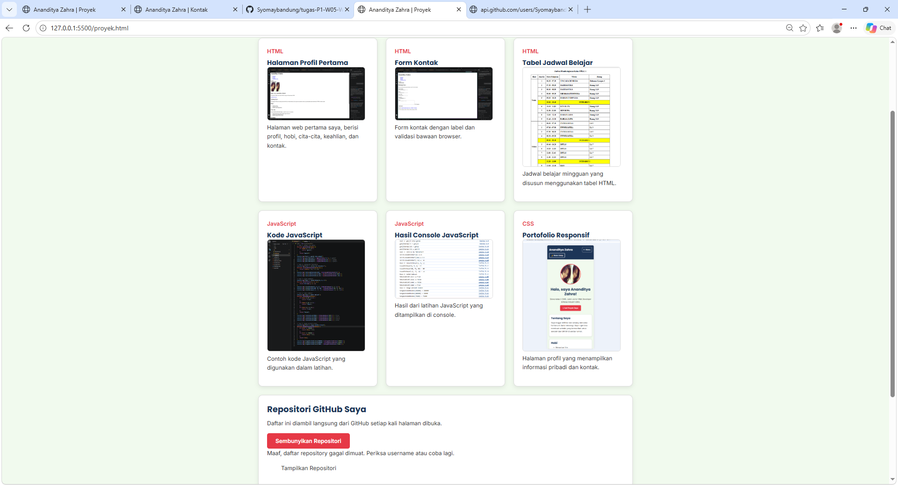

# Portofolio Ananditya Zahra
Website portofolio pribadi yang saya buat di Kelas Industri UBIG (Paket 1, Minggu 01 sampai 05).
Website ini tampil rapi di ponsel, tablet, dan laptop.
## Tampilan

## Fitur
- Halaman **Beranda** berisi profil, hobi, cita-cita, keahlian, dan jadwal belajar
- Halaman **Proyek** berisi daftar proyek dalam bentuk kartu
- Halaman **Kontak** berisi form untuk menghubungi saya
- Halaman **Kalkulator Nilai** berisi form untuk menghitung rata-rata suatu nilai
- Tampilan responsif dengan Flexbox dan *media query*
- Tampilan mode gelap dan terang
- Penghitung karakter dalam pesan yang dikirimkan minimal 300 karakter
- Tampilan soal yang dikerjakan di console
- Menampilkan memuat pada repository
- Menyambungkan repository GitHub dengan poject portofolio
- Tampilan keahlian json pada vscode dan console (network) 
- Audit menggunakan LightHouse
## Teknologi
- HTML5
- CSS3 (Flexbox dan media query)
- Git dan GitHub
- JavaScript
- JSON
- README
## Skor LightHouse
- Performance   : 100;100;100;100
- Accesbillity  : 94;96;96;95
- Best Practices: 100;100;100;100
-SEO            : 100;100;100;100
## Tautan
- Website: menyusul setelah *deploy* ke Vercel
- Dibuat oleh: Ananditya Zahra, SMKS BRANTAS KARANGKATES